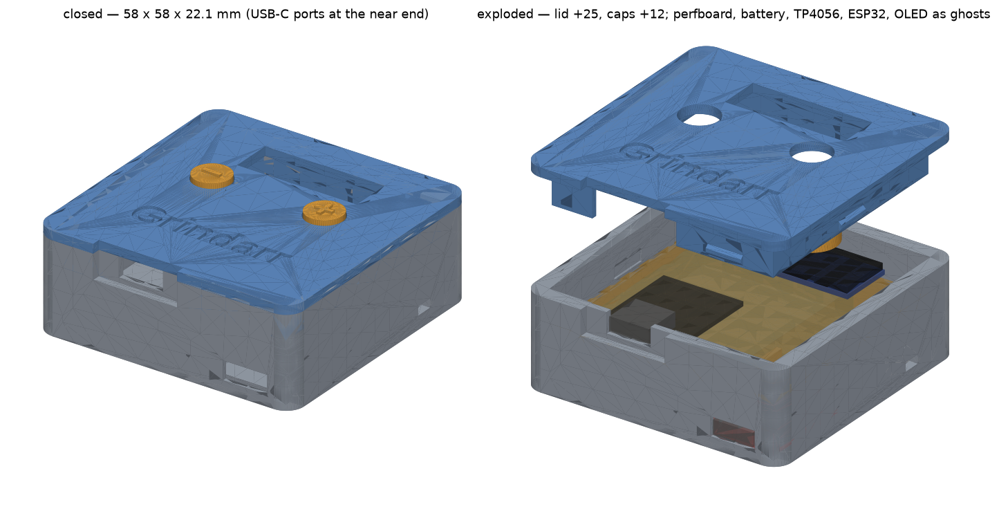
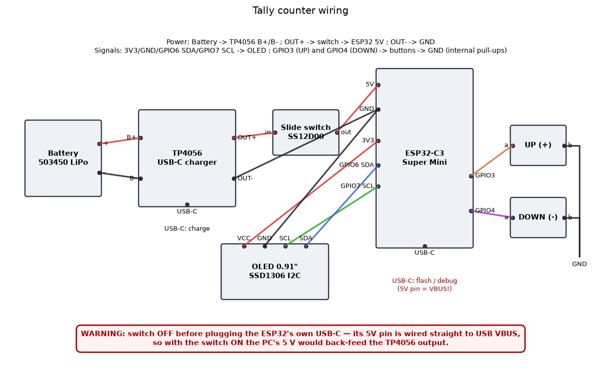
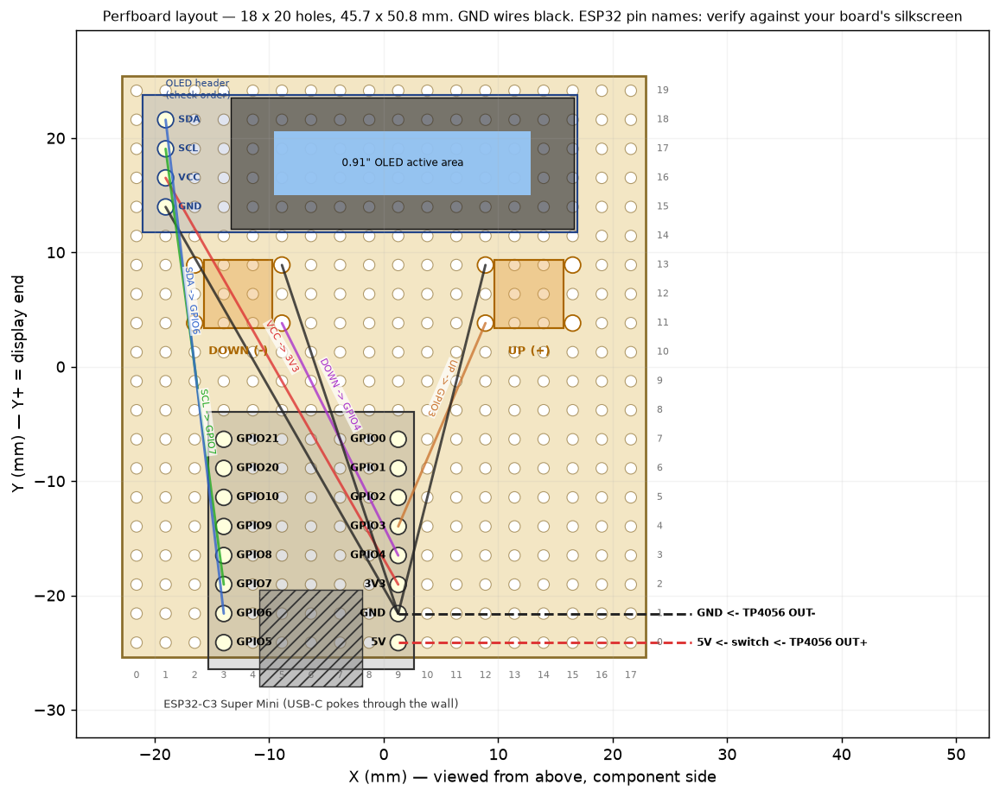

# ESP32 Tally Counter

A pocket tally counter: two buttons, a 0.91" OLED, an ESP32-C3 Super Mini and a
850 mAh LiPo in a 58 × 58 × 22 mm 3D-printed case. Right button counts up, left
counts down, hold both for a second to reset. The count survives power-off, the
device deep-sleeps after 30 s and wakes on any button, and a slide switch cuts
power completely. Two firmwares share the same hardware: a **plain** one with no
radio, and an **ESPHome** one that exposes the count to Home Assistant. Everything
— the case STLs, the README images, both firmware binaries — is generated from
source through Docker + `make`; nothing is installed on the host.


*Closed (58.0 × 57.6 × 22.1 mm, both USB-C ports at the near end, "Grindarr"
engraved in the lid) and exploded, with perfboard, battery, TP4056, ESP32 and OLED
as ghosts.*

**Interactive preview:** [ardakilic.github.io/esp32-tally](https://ardakilic.github.io/esp32-tally/)
— or open [`case/preview.html`](case/preview.html) locally (self-contained, works offline).

## Features

- **UP** (right, "+") and **DOWN** (left, "−") buttons, range 0…99999, DOWN stops
  at 0; a click counts on **release**, debounced 20 ms.
- Hold **both ≥ 1 s → reset to 0**; the two releases that follow do not count.
- **Brew-method labels** beside the count (Comandante C40 MK4 grind chart): the count
  keeps its big digits, and every method whose click range contains it is listed one
  per line to its right, in table order (7 → "Turkish" over "Espresso"), up to four;
  nothing when no range matches. The table is
  [`firmware/common/grind_chart.h`](firmware/common/grind_chart.h), shared by both
  firmwares; an empty table turns the labels off
  ([Brew-method labels](#brew-method-labels-grind-chart)).
- Count **saved to flash once per burst, on both firmwares**: every click restarts a
  2 s timer, clicking with gaps under 2 s never writes, and the pause after the last
  click writes the final count once. Going to sleep writes a pending count first; a
  power cut (slide switch off) during a burst or within 2 s of the last click loses the
  clicks since the previous write. Plain: `SAVE_DELAY_MS` in
  `firmware/plain/platformio.ini` `build_flags` (0 = every click). ESPHome: the
  `save_delay` substitution, used by the restart-mode `save_later` script, with
  `flash_write_interval: never`.
- **30 s idle → OLED off + deep sleep**; either button wakes it (that press is not
  counted). The plain build also wakes silently once an hour (and on a backoff while
  a button is held) to re-arm the buttons, then sleeps again. Slide switch = hard
  power off.
- **Charging over USB-C** through a TP4056 module with cell protection; the ESP32's
  own USB-C is for flashing only and sits behind the lid (see [Power notes](#power-notes)).
- ESPHome variant adds Home Assistant entities: number **Tally Count** (settable),
  button **Reset Tally**, switch **Keep Awake** (blocks the idle sleep so OTA can run).
- Case: snap-fit lid (four detents, bite tunable with [`--snap-bite`](#fit-tuning),
  `0` = plain friction fit), no screws, no supports, 4 parts, 26 cm³ of plastic; the
  lid is engraved "Grindarr" by default — any text or none ([Engraving](#engraving)).

## Bill of materials

| Part | Notes |
|---|---|
| ESP32-C3 Super Mini | the 18 × 22.5 mm board with two 8-pin rows; on male pin headers |
| 0.91" SSD1306 OLED, 128 × 32, I2C | 4-pin header (GND VCC SCL SDA on most — verify yours), address 0x3C |
| 2 × 6 × 6 mm tact switches | any height 4.3–6 mm; default 4.3, see [`--tact-height`](#fit-tuning) |
| TP4056 USB-C charger module | the common 17 × 28 mm board **with** DW01 protection (the variant with OUT+/OUT− pads); 1 A default |
| SS12D00 slide switch | 3-pin, 1P2T, 8.8 × 3.9 × 3.5 mm body, 2 mm travel |
| 1S LiPo pouch, 503450 | 34 × 50 × 5 mm, 850 mAh, with PCM and JST-PH lead; other sizes via [`--battery`](#fit-tuning) (T ≤ 7 mm) |
| [Özdisan 5 × 5 cm perfboard](https://www.ozdisan.com/p/prototipleme-devreleri-621/ozd-arduino-delkl-pertnaks-5x5-643014) | single-sided, 50 × 50 mm, **18 × 19 holes** at 2.54 mm, used **whole** — no cutting |
| Male pin headers | 2 × 8 for the Super Mini |
| Hook-up wire | thin silicone wire for the dozen connections below |
| 4 printed parts | base, lid, cap "+", cap "−" ([Case](#case)) |
| Hot glue | one dab to hold the slide switch — never on the cell or the perfboard |
| Kapton tape (or 0.3–0.5 mm PET / fish paper) + double-sided foam tape | insulate the perfboard's solder side; fix cell and TP4056 to the floor ([Assembly](#assembly)) |
| Optional: 3 mm foam pad | under the OLED's free end so it can't rock on its header |

## Wiring



| From | To | Notes |
|---|---|---|
| Battery + / − | TP4056 `B+` / `B−` | solder the JST-PH lead directly to the pads |
| TP4056 `OUT+` | slide switch common | the switched node is on the **high** side |
| slide switch throw (one of the two) | ESP32 `5V` | `5V` = USB VBUS net, see Power notes |
| TP4056 `OUT−` | ESP32 `GND` | OUT− is the protection-switched ground — star all grounds here |
| ESP32 `3V3` / `GND` | OLED `VCC` / `GND` | |
| ESP32 `GPIO6` | OLED `SDA` | I2C 0x3C |
| ESP32 `GPIO7` | OLED `SCL` | |
| UP button, pin 1 / pin 2 | ESP32 `GPIO3` / `GND` | internal pull-up, active low |
| DOWN button, pin 1 / pin 2 | ESP32 `GPIO4` / `GND` | internal pull-up, active low |



The perfboard is an [Özdisan 5 × 5 cm single-sided board](https://www.ozdisan.com/p/prototipleme-devreleri-621/ozd-arduino-delkl-pertnaks-5x5-643014)
used **whole**: 50 × 50 mm, 18 × 19 holes at 2.54 mm, no cutting. It drops onto the
ledge inside the case with the 19-hole direction along the length (Y, towards the
display end) and the 18-hole direction across (X). The hole grid is centred on the
board — outer row centres 2.14 mm from the Y edges, outer column centres 3.41 mm
from the X edges. Single-sided means the square solder pads are on one face only:
components sit on the bare face, pads underneath. The drawing above is the
**component-side view**, so hole positions appear mirrored once you flip the board
to solder. Column 0 / row 0 is the bottom-left corner when the display end is up.
The Super Mini's two pin rows go into **columns 3 and 9, rows 0…7**, USB-C at the
bottom edge — column 3 carries 5V, GND, 3V3, GPIO4, GPIO3, GPIO2, GPIO1, GPIO0
from the USB end up and column 9 carries GPIO5, GPIO6, GPIO7, GPIO8, GPIO9,
GPIO10, GPIO20, GPIO21 (verified against the mischianti photo pinout and on a
real board, 2026-10-10); because row 0 sits only 2.14 mm from the board edge the receptacle
face ends up just 1.72 mm past the perfboard, so the case wall is relieved from
the outside to a 1.4 mm thin wall there and the port sits 0.2 mm behind it.
The two tact switches are centred at **X ±12.7 mm on row 11** — their four legs land
in columns 2 & 5 (DOWN) and 12 & 15 (UP), rows 10 & 12. The OLED's 4-pin header
goes into **column 1, rows 14…17**, with the module extending to the right across
the top of the board. Pin names in the drawing match the real board — still
**verify against your board** before soldering, Super Mini pinout images disagree
on mirroring; OLED header order varies (GND VCC SCL SDA on most modules).

> **Rework note.** If you built the board from a drawing dated before 2026-10-10,
> the two ESP32 columns were mirrored: move every wire that lands on the module
> to the other column at the same row (5V, GND, 3V3, SDA, SCL, UP, DOWN) — the
> firmware is unchanged.

### Power notes

Verified from the Super Mini schematic (links in
[Verified part geometry](#verified-part-geometry)):

- **The `5V` header pin is the USB VBUS net** — it sits *before* the BAT60J Schottky
  diode and the ME6211 3.3 V LDO. **Flip the slide switch OFF (or unplug the
  battery) before plugging a cable into the ESP32's own USB-C**, otherwise the PC's
  5 V back-feeds the TP4056 output and the battery. This is why the case hides the
  ESP32 port: you open the lid to flash.
- Battery path: V<sub>bat</sub> → BAT60J (≈0.2–0.3 V drop) → ME6211 → 3V3. Regulation
  holds down to ≈3.6–3.7 V; below that 3V3 follows the cell down. Below 3.0 V on 3V3
  the C3, its flash and the OLED are out of spec, and the brownout detector only trips
  at 2.51 V (level 7), so expect a flaky display or odd resets near empty — the Wi-Fi
  build browns out first. The TP4056's DW01 cuts the cell at 2.4 V regardless, so the
  cell is not damaged.
- The Super Mini's **red power LED** sits on VSYS, after the BAT60J (mischianti
  schematic), so the cell keeps it lit through deep sleep; its current is unmeasured
  but dwarfs the chip's. Flip the switch when storing the counter, or desolder that
  LED for µA-level sleep.
- **Charge current** is the TP4056 default **1 A** (R<sub>PROG</sub> 1.2 kΩ): ≈1.2 C
  for the 850 mAh cell, above the usual ≤ 1 C. Swapping R<sub>PROG</sub> for 2 kΩ
  (≈ 580 mA, ≈0.7 C) is the gentler option.
- **Charge with the switch OFF** so the TP4056's full-charge indication isn't
  confused by the load.
- **Charging/USB test with the switch ON** back-feeds the cell through `OUT+` =
  `B+` with no current control; macOS may disable the port ("USB Accessories
  Disabled"). A 5 V charger on the ESP32's port pushes an estimated 1.5–2 A into the
  cell through the slide switch, with only the DW01's ≈4.3 V over-charge cut-off as
  protection. **Switch OFF first, always.**
- `OUT−` is the protection-switched node (DW01 switches the low side): star the
  grounds at `OUT−`, never at `B−`.

## Firmware

Both firmwares implement the same behaviour and pinout; pick one. Build outputs
are gitignored — `make` regenerates them from pinned Docker images.

### Plain (no network)

[`firmware/plain/`](firmware/plain/) — PlatformIO + Arduino core 3.3.12
(pioarduino platform 55.03.312-1), board `nologo_esp32c3_super_mini`,
`flash_mode = dio`, one library: U8g2 2.36.18.

| File | Role |
|---|---|
| [`platformio.ini`](firmware/plain/platformio.ini) | platform / board / U8g2 pins, `build_flags` (`SAVE_DELAY_MS`, `-I ../common`) |
| [`src/tally_logic.h`](firmware/plain/src/tally_logic.h) | the button/count state machine, the save-delay rule (`struct SaveDelay`), the deep-sleep wake plan (`struct WakePlan`: GPIO for the buttons that are up + a timer, hourly or a 2→600 s backoff while one is held) and the ring of the last 8 boots (`BootLog`) — pure C++, no Arduino |
| [`src/main.cpp`](firmware/plain/src/main.cpp) | pins, OLED (big count with the matching brew methods stacked to its right, redrawn only on a click), NVS (`Preferences`, flushed when `SaveDelay` is due and before sleep), loop watchdog, deep sleep with the silent timer safety wake, boot blink, RTC breadcrumbs + NVS boot log + serial report |
| [`../common/grind_chart.h`](firmware/common/grind_chart.h) | brew-method table `GRIND_CHART`, `GRIND_MAX_LINES` (4) and `grind_matches()`, shared with the ESPHome build |
| [`test/tally_logic_test.cpp`](firmware/plain/test/tally_logic_test.cpp) | assert-based self-test of the state machine, the save delay (burst → one write, 1.5 s gaps → none, `millis` wrap, delay 0, flush before sleep), the wake plan (hourly when both are up, 2…512, 600 backoff, both held still gets a timer, which timer wake counts as a press), the boot-log ring and the grind chart (table sanity, match oracle over counts 0…100, the line cap, one shipped-table spot check), runs on the host in `gcc:14` |
| [`Dockerfile`](firmware/plain/Dockerfile) | `python:3.12-slim` + platformio 6.2.0 + git, `PLATFORMIO_CORE_DIR=/pio` |

```bash
make plain-test   # host self-test: prints OK
make plain        # -> firmware/plain/build/tally-plain.factory.bin
```

Result: RAM 4.6 % (15.2 KB), Flash 25.8 %, merged image 410 KiB. The
`.factory.bin` is the complete flash image (bootloader @0x0, partitions @0x8000,
boot_app0 @0xe000, app @0x10000) — flash it at offset 0. No OTA: reflashing means
opening the lid.

Liveness check: the Super Mini's **blue LED** (GPIO8) blinks ≈0.3 s on every boot
and wake, so a blink with a dark OLED means the MCU runs and the display (or its
wiring) is the problem. A hang anywhere (I2C, NVS, the loop, sleep entry) trips the
loop watchdog after 5 s: panic, reboot, blink — never a dark, dead counter.

Serial report (USB serial, 115200). At boot it prints, for example,

```
boot reset=1 (power-on) wake=0 rtc=cold last=rtc lost sleeps=0 timer_wakes=0
log 7/9: reset=1 (power-on) last=rtc lost sleeps=0
log 8/9: reset=6 (task-wdt) last=awake sleeps=41
log 9/9: reset=1 (power-on) last=rtc lost sleeps=0
count=123 (restored)
```

then `count=N` per click; **any key sent** prints the `boot` and `log` lines again
(the boot copy waits in a 1 KiB buffer, but is easily missed). `boot` is this run:
the reset and wake codes, `rtc=warm|cold`, the stage the previous run stopped in
(`boot`, `awake`, `flush`, `oled-off`, `sleep`) and the deep sleeps / silent timer
wakes since the RTC memory was last lost. The `log` lines are the last 8 boots that
were *not* a deep-sleep wake, kept in NVS (`<k>/<total>`, oldest first) — one flash
write per such boot, none per wake.

| `reset` | Meaning |
|---|---|
| 1 power-on | power applied — **or the RST key**: the C3 reports both as power-on |
| 3 sw | software restart |
| 4 panic | crash, rebooted |
| 5 int-wdt | interrupt watchdog |
| 6 task-wdt | loop watchdog: something hung for 5 s |
| 8 deep-sleep | woken by a button (or the timer) |
| 9 brownout | 3V3 fell below ≈2.5 V |
| 11 usb | reset over USB (flasher, esptool-js) |

`rtc=cold` / `last=rtc lost` means the RTC memory was gone: **the board lost power**
(switch off, the cell protection tripped, a broken joint) **or the RST key was
pressed** — EN low powers the C3 down, and both report reset 1. So when it goes
dark, meter it before pressing RST ([Field notes](#field-notes)): RST wipes the
breadcrumbs, and if RST revives it, that alone says the chip had power. `rtc=warm`
with reset 9 is a brownout (IDF handles it as a software reset that keeps RTC memory
— from the IDF source, not yet seen on the device); with task-wdt/panic, `last` says
where the firmware was.

Reading it on macOS with nothing installed:

1. Switch OFF (`5V` = VBUS, see [Power notes](#power-notes)), open the lid, plug a
   **data** cable into the ESP32's USB-C.
2. Either `ls /dev/cu.usbmodem*`, then `screen /dev/cu.usbmodemXXXX 115200` (quit:
   Ctrl-A K y), or Chrome/Edge → <https://espressif.github.io/esptool-js/> →
   **Console** (don't press its Reset — that would log a USB reset). Type any key.
3. It still sleeps after 30 s idle and the port vanishes; press a button and reopen.

Wake sources: every deep sleep arms the GPIO wake of the buttons that are up **and a
timer**. Both up → the timer is a 1 h safety wake: the chip boots, finds no armed
button down and goes straight back to sleep — no blink, no serial, no flash write,
no OLED, count unchanged. A button that is down at the 30 s deadline is left out of
the GPIO mask (its low level would re-wake at once) and re-checked by the timer on a
2, 4, 8 … 600 s backoff. That happens when one is held ≥ 30 s; when both are held,
which also zeroes the count (both ≥ 1 s → 0) unless one has been held since the wake
press; or when a press lands in the 20 ms debounce window at the deadline. A
stuck-low button therefore cannot hold the chip awake and the timer always comes
back to it, but the interval grows while it stays down — it reaches the 600 s cap
after ≈17 min — so after a long hold a press of that button is seen only once a
timer wake has found it up and re-armed it, up to 10 min after its release.
`setup()` still seeds the button state instead of waiting for a release, so the
wake press doesn't count. Cost, estimated and unmeasured: ≈1–2 µAh per timer wake (≈0.2 s of boot at ≈20–25 mA), i.e. ≈1–2 µA
averaged at one per hour — roughly 2–4 % of the ≈50 µA sleep budget.

### ESPHome (Home Assistant)

[`firmware/esphome/tally.yaml`](firmware/esphome/tally.yaml) — ESPHome 2026.9.1,
`esp-idf` framework, board `nologo_esp32c3_super_mini`. Substitution
`idle_sleep: 30s`. Entities in HA: number **Tally Count** (0…99999, box mode,
settable), button **Reset Tally**, switch **Keep Awake**.

1. Secrets: `cp firmware/esphome/secrets.yaml.example firmware/esphome/secrets.yaml`
   and fill in `wifi_ssid`, `wifi_password`, `api_key` (`openssl rand -base64 32`;
   used for both the HA API and OTA) and `ap_password` (fallback hotspot, ≥ 8 chars).
   `secrets.yaml` is gitignored; `make esphome` refuses to run without it.
2. Build (the container needs internet the first time: the Roboto font comes from
   Google Fonts at compile time, the IDF toolchain lands in the cache volume):

```bash
make esphome-config   # validate tally.yaml
make esphome          # -> firmware/esphome/.esphome/build/tally/build/firmware.factory.bin (987 KB)
                      #    and firmware.ota.bin next to it
make esphome-ota      # compile + OTA to DEVICE (default tally.local) after the first USB flash
```

Result: Flash 51.5 %, RAM 33.1 %. The device **still sleeps after 30 s** with Wi-Fi: HA
shows it unavailable in between, it reconnects on every wake and pushes the count.
Before an OTA, press a button to wake it and turn on **Keep Awake** within 30 s;
turning it off re-arms the idle timer.

### Brew-method labels (grind chart)

Both firmwares show, to the right of the count, the brew methods whose grind range
contains it. The table is one header compiled by both,
[`firmware/common/grind_chart.h`](firmware/common/grind_chart.h); the shipped rows
are for a Comandante C40 MK4, clicks from zero, from
[Honest Coffee Guide's table](https://honestcoffeeguide.com/comandante-c40-mk4-grind-settings/)
(its chart runs French Press and Cold Brew past 40; the table caps them at the
grinder's 1090 µm maximum):

| Method | Clicks from zero |
|---|---|
| Turkish | 2–8 |
| Espresso | 7–13 |
| V60 | 15–25 |
| Aeropress | 12–35 |
| Pour Over | 16–34 |
| French Press | 26–40 |
| Cold Brew | 30–40 |

The count keeps the same big digits whether or not a method shows. Matching methods
are stacked one per line to its right, left-aligned, in table order (7 → Turkish,
Espresso; 30 → Aeropress, Pour Over, French Press, Cold Brew), and digits plus names
are centred together, so a count no range covers sits centred on its own. One to
three names use the larger label font; a fourth match switches all four to a smaller
one; a fifth and beyond is not shown. A name wider than the space left is cut at the
right edge — with the shipped table the widest group (count 26, three names) ends at
column 120 of 128. The screen is static and redrawn only on a click.

To use your own grinder or ranges, edit `GRIND_CHART`: one `{from, to, "Name"}` row
per method, both ends inclusive, table order = display order (and decides which
four show when more overlap); `{}` turns the labels off. Rebuild both firmwares
(`make plain`, `make esphome`). `make plain-test` checks the table (from ≥ 0,
from ≤ to, a non-empty name), the matched names and their order for every count
0…100 against the table (so it follows your edits), and the cap (only the first
names are kept, the full match count is still reported). One literal spot check of
the shipped rows in
[`tally_logic_test.cpp`](firmware/plain/test/tally_logic_test.cpp), under
"shipped table; update if you edit it", fails when your edit changes what 0, 7 or
41 shows — update those lines with it.

### Flashing

No build needed: grab the prebuilt `.factory.bin` files from the
[latest release](https://github.com/Ardakilic/esp32-tally/releases/latest)
(rebuilt on every push to `main`; the [landing page](https://ardakilic.github.io/esp32-tally/)
links them directly).

Docker Desktop on macOS cannot pass USB through, so flash from the browser:

1. **Slide switch OFF** (or battery disconnected) — see [Power notes](#power-notes).
2. Open <https://web.esphome.io> in Chrome or Edge → **Connect** → pick the Super
   Mini's serial port → **Install** → choose the `.factory.bin`
   (`firmware/plain/build/tally-plain.factory.bin` or
   `firmware/esphome/.esphome/build/tally/build/firmware.factory.bin`).
3. If no port shows up, hold **BOOT** (GPIO9) while plugging the cable in, then retry.

Both images are full factory images, so switching between the two firmwares is just
another flash. After the first ESPHome flash, later updates go over the air
(`make esphome-ota`). Note: the release ESPHome binary is built with placeholder
Wi-Fi/API credentials (CI has no real secrets) — it counts standalone and you can
set Wi-Fi via its captive-portal hotspot, but for Home Assistant rebuild it with
your own `secrets.yaml`.

## Case

[`case/`](case/) — one Python script ([`generate.py`](case/generate.py), shapely +
trimesh + manifold3d, pinned, `python:3.14-slim`) builds four watertight STLs; the
same constants drive the README images and the geometry self-test.

### Parts

| STL | Size (mm) | Volume | Print orientation |
|---|---|---|---|
| [`case/stl/tally-base.stl`](case/stl/tally-base.stl) | 58.0 × 57.6 × 20.1 | 17.2 cm³ | upright, as exported |
| [`case/stl/tally-lid.stl`](case/stl/tally-lid.stl) | 58.0 × 57.6 × 9.5 | 7.4 cm³ | as exported (top face down) |
| [`case/stl/tally-cap-plus.stl`](case/stl/tally-cap-plus.stl) | 11 × 11 × 6.7 | 0.4 cm³ | on its flange, as exported |
| [`case/stl/tally-cap-minus.stl`](case/stl/tally-cap-minus.stl) | 11 × 11 × 6.7 | 0.4 cm³ | on its flange, as exported |

Closed: **58.0 × 57.6 × 22.1 mm** (frame opening 50.6 × 50.6, cavity 54.0 × 53.6).
Shell 2.0 mm walls / floor / lid plate, 1.2 mm lid skirt, 4 mm outer corner radius.
Features: snap-fit lid whose skirt slides *inside* the frame (0.28 mm clearance
per side) and clamps the perfboard onto an internal ledge — four 8 mm snap detents
on the skirt's outer face (X− and X+ walls at Y = 0, Y+ wall at X = 0, Y− wall
right of the USB notch at X = +14.2) click into closed 0.5 mm grooves in the
frame's inner face; the crest bites 0.4 mm past the frame, both ramps are 45° so
the lid still pries off, and `--snap-bite 0` gives the plain friction fit; 27 × 9 mm OLED
window; two Ø8.4 mm cap holes; "Grindarr" engraved 0.6 mm into the lid top
([Engraving](#engraving)); an open-top slot in the bottom wall for the ESP32's
USB-C, closed by a notch in the lid skirt (left, flash/debug) — the wall's outer
face is relieved there to a 1.4 mm thin wall, 19 mm wide, and the lid plate is
notched over it so a plug reaches the port; a USB-C window at floor level for the
TP4056 (right, charge); slide-switch slot on the right wall; 10 × 1.5 mm pry notch
at the display end.

### Printing

- 0.2 mm layers, 0.4 mm nozzle. **PETG preferred**: the lid skirt flexes ≈0.7 mm
  riding over the snap bumps. For PLA print a shallower bite,
  `make case GEN_ARGS="--snap-bite 0.3"` (or `--snap-bite 0` for the plain friction
  fit).
- **No supports** in the exported orientations — the overhangs are the ledge's
  underside inside the base, 1.5 mm (ends) to 1.7 mm (sides) wide, and the four
  snap-groove ceilings (0.5 mm deep); both print fine at 0.2 mm layers. The lid's
  snap bumps are 45° ramps and print face-down as before.
- The **thin 1.4 mm wall around the ESP32 port is intentional** (plug relief in the
  bottom wall's outer face, 19 mm wide, from 2 mm above the perfboard up to the
  rim) — don't thicken it in the slicer.
- Base upright; lid as exported (top face on the bed, so the window edge, the
  engraving and the outer face are clean); caps on their flanges.

### Assembly

1. **TP4056**: USB-C first into the lower opening at the bottom end, the PCB end
   sinks 1 mm into its wall pocket; it lies against the right wall, the stop block
   sits behind it.
2. **Battery** into the left bay (lead towards the TP4056; the rib between them
   keeps the pouch off the charger).
3. **Slide switch**: drop it between its two ribs from the inside, handle through
   the slot in the right wall; a dab of hot glue holds it.
4. Solder and route the wires (table above); keep them below the ledge.
5. **Insulate the solder side**: clip every pin tail under the perfboard to
   ≤ 1 mm, then cover the **whole** solder side with Kapton/polyimide tape (two
   layers over the header stubs) or a 0.3–0.5 mm PET / fish-paper sheet cut to
   50 × 50. The ESP32 and OLED header stubs sit directly over the battery bay with
   ≈2 mm of air; a LiPo pouch is 40 µm aluminium foil under 25 µm of nylon, so two
   stubs pressed into it are shorted together (SDA and SCL are 2.54 mm apart), and
   the TP4056's USB shell and `B−`/`OUT−` pads are ground.
6. **Fix the cell and the TP4056 to the case floor** with double-sided foam tape —
   never hot glue against the pouch or the perfboard underside. Hot glue
   (175–200 °C) plus pressure on a pouch is a safety risk, and glue that shrinks or
   is peeled off later cracks single-sided solder joints (the OLED's four first).
7. **Perfboard** onto the ledge, pads down, ESP32 USB-C end towards the bottom
   edge, so the receptacle sits in its wall slot.
8. **Caps** into the lid from below — "+" on the right, "−" on the left (as held,
   display up).
9. **Lid** on: the skirt notch goes over the ESP32 end; press down until it clicks
   on all four sides.

Open it by lifting with a coin in the pry notch at the display end — the detents'
release ramps are 45°, so the lid pries off. Optionally stick a 3 mm foam pad under
the OLED's free end before closing.

### Field notes

First build, 2026-10-10: with the TP4056 and cell hot-glued under the board the
OLED stayed dark until the glue came off — contact through the header stubs and
joint stress, not EMI; hence steps 5–6. Dark-display triage, in order: press
**RST**; the serial port appears (`ls /dev/cu.usbmodem*`) and vanishes after 30 s
(deep sleep); [web.esphome.io](https://web.esphome.io) → **Logs** shows `count=N`
per click; the blue GPIO8 blink on boot = MCU alive; then meter the OLED header
(VCC 3.3 V, SDA/SCL idle at 3.3 V) and reflow. A deep-sleeping ESP32-C3 does
**not** wake when USB is plugged in — only a button or RST does — and with the
slide switch ON a USB plug back-feeds the cell ([Power notes](#power-notes)).
Digits cut off at the top with blank rows below were a placement bug in the plain
firmware (U8g2's centre mode on a font with a deep descent), not the panel — fixed
2026-10-11; reflash.

2026-10-18, dark after sleep: with the 850 mAh cell full (4.1 V at the TP4056
`B+`/`B−`), the counter went into its 30 s idle sleep and stayed dark — neither
button woke it, no blue blink. With the switch ON, a 5 V USB-C charger in the
ESP32's own port revived it (at the plug, not when the lid came off), count kept;
soldering and solder-side insulation checked fine afterwards. The cause is **not
yet established**. A firmware cause — a hang (that day's firmware had no loop
watchdog) or a sleep with no wake source armed — leaves the ESP32 powered, and a
dataless 5 V plug can't wake or reset a powered C3 (no USB wake source; VBUS only
reaches the BAT60J → ME6211, EN is an RC + the RST key). The one path that empties
the wake mask, both buttons down at the 30 s deadline, would also have zeroed the
count (both held ≥ 1 s → 0) unless one had been held since the wake press — and the
count was kept. So firmware is unlikely, but not excluded until the meter readings
below or the new boot log confirm it. Leading hypothesis: the ESP32 was **unpowered
with a full cell** — the DW01's over-current/short latch, which holds while the load
stays connected and is released by anything that looks like a charger (the back-fed
5 V through the 8205A body diode is one), or an intermittent joint in the power
path. `OUT+`/`OUT−` were not measured, so this is inferred, not shown. The plain
firmware now adds a loop watchdog, a timer wake beside the button wake, and RTC
breadcrumbs + an NVS boot log that tell lost RTC memory (`rtc=cold`,
`last=rtc lost`: power cut or RST) from a hang ([Plain](#plain-no-network)).
Next time, **before plugging anything in or pressing RST**, meter `B+`/`B−`,
`OUT+`/`OUT−` and `OUT−`/`B−`, then the ESP32's `5V` and `3V3` pins against its own
`GND` pin (= `OUT−`); then press RST; then switch OFF → ON:

| B+/B− | OUT+/OUT− | OUT−/B− | ESP `5V` / `3V3` | Meaning |
|---|---|---|---|---|
| 4.1 | ≈0 | ≈4 | 0 | DW01 latched (`OUT−` floats up through the load) — find the short/over-current (solder side, wiring) |
| 4.1 | 4.1 | ≈0 | 0 | open between the TP4056 and the ESP32 — switch, wire or joint |
| 4.1 | 4.1 | ≈0 | ≈4 / 3.3 | ESP32 powered — read the boot log over serial |

### Fit tuning

Printers and kits vary; the four fit parameters (and the lid engraving) are
command-line flags shared by the generator, the image renderer and the verifier:

| Flag | Default | Controls |
|---|---|---|
| `--clear-friction` | 0.28 mm | lid skirt clearance to the frame per side (filtarr's calibrated value); tune in ±0.04 steps |
| `--snap-bite` | 0.4 mm | how far the four lid snap detents bite past the frame's inner face (PETG); PLA ≈ 0.3; `0` = no detents, the plain friction fit (STLs byte-identical to the pre-snap case) |
| `--tact-height` | 4.3 mm | tact switch height, PCB top to plunger top — 4.3 / 5 / 6 are fine, ≤ 6.0 with the default 7.5 mm lid clearance |
| `--battery` | 34x52x6 | battery pouch envelope W×L×T incl. tabs and swelling; T ≤ 7 |
| `--engraving TEXT` | `Grindarr` | text engraved into the lid top ([Engraving](#engraving)); shortcut `make case ENGRAVING="My Text"` |
| `--omit-engraving` | off | plain lid top, no text; shortcut `make case OMIT_ENGRAVING=1` |

```bash
make case GEN_ARGS="--clear-friction 0.32"                  # lid too tight
make case GEN_ARGS="--snap-bite 0.3"                        # PLA lid; 0 = no detents
make case GEN_ARGS="--tact-height 5"                        # taller switches
make case GEN_ARGS="--battery 30x40x5"                      # smaller cell
make case ENGRAVING="My Text"                               # other lid text
make case OMIT_ENGRAVING=1 GEN_ARGS="--tact-height 5"       # plain lid; combinable
make case-verify GEN_ARGS="--clear-friction 0.32 --tact-height 5"   # check before printing
```

Every other dimension (walls, PCB_Z 9, LID_CLEAR 7.5, window 27 × 9, switch
position SW_Y 14, snap bump SNAP_LEN 8 / SNAP_CREST 0.8, …) is a named constant
with a why-comment at the top of
[`case/generate.py`](case/generate.py).

### Engraving

The lid top carries **"Grindarr"** by default: Liberation Sans Bold, 6 mm cap
height, recessed 0.6 mm (3 layers), centred at (0, −13) in the free band between
the button caps and the USB-port edge, reading upright with the display at the
top. The lid prints top-face-down, so the recess sits on the bed and comes out
crisp. `--engraving TEXT` / `--omit-engraving` (or the `ENGRAVING=` /
`OMIT_ENGRAVING=1` make shortcuts, which append to `GEN_ARGS`) go to
`generate.py`, `verify.py` and `render_docs.py` alike. Longer text auto-shrinks
below 6 mm to stay inside the band; empty text or a glyph the font has no outline
for is rejected (`p.error`). The generator's summary line — repeated in the
preview's Dimensions panel — reads `Engraving: "Grindarr" (6 mm, 0.6 deep)` or
`Engraving: omitted`. The output is `stl/tally-lid.stl` either way; the committed
lid, renders and preview carry "Grindarr". The font comes from `fonts-liberation`
in the case Docker image.

## Interactive preview

Online at **[ardakilic.github.io/esp32-tally](https://ardakilic.github.io/esp32-tally/)**
(the [Pages workflow](.github/workflows/pages.yml) republishes the whole checkout on
every push to `main`; enable Pages once with Source = GitHub Actions), or locally —
[`case/preview.html`](case/preview.html) is one self-contained file (three.js and the
four STLs embedded, no internet needed), open it in any browser. Lift the lid and caps
with the **Explode** slider, toggle each part, switch on **X-ray lid** or the ghost
electronics (perfboard, battery, TP4056, ESP32, OLED, slide switch), and download
the exact STLs from the **Print these four** list; the Dimensions panel repeats the
tolerance, snap, shell and engraving summary `generate.py` prints, so a tuned build shows
its `GEN_ARGS` (the lid's engraving is in the embedded STL). The landing page ([`index.html`](index.html)) links the preview, the
STLs, the README images and both firmware folders.

## Regenerating everything

```bash
make                  # case + plain + esphome
```

| Target | Does | Output |
|---|---|---|
| `make case` | build image, `generate.py`, `tools/render_docs.py`; `ENGRAVING="…"` / `OMIT_ENGRAVING=1` set the lid text | `case/stl/*.stl`, `case/preview.html`, `index.html`, `case/docs/*.png` |
| `make case-verify` | 105 geometry checks on in-memory builds (70 with `--snap-bite 0`, 101 with `--omit-engraving`), exit 1 on failure | PASS/FAIL table |
| `make vendor` | fetch the latest three.js module build (stdlib-only, bare `python:3.14-slim`) | `case/vendor/three.{module,core}.min.js`, `THREE_VERSION` |
| `make plain` | build image, `pio run`, copy the factory image | `firmware/plain/build/tally-plain.factory.bin` |
| `make plain-test` | state-machine + grind-chart self-test in `gcc:14` | `OK` |
| `make esphome` | `esphome compile` (needs `secrets.yaml`) | `firmware/esphome/.esphome/build/tally/build/firmware.{factory,ota}.bin` |
| `make esphome-config` | `esphome config` | validated YAML |
| `make esphome-ota` | `esphome run --device $(DEVICE)` | flashed device |
| `make image-case` / `make image-plain` | (re)build the two Docker images | — |
| `make clean` | removes `case/stl case/docs case/preview.html index.html firmware/plain/.pio firmware/plain/build firmware/esphome/.esphome` | — |

Pinned images: `python:3.14-slim` + [`case/requirements.txt`](case/requirements.txt)
(the exact wheels the committed STLs were triangulated with) + Debian's
`fonts-liberation` for the lid engraving, `python:3.12-slim` +
platformio 6.2.0, `ghcr.io/esphome/esphome:2026.9.1`, `gcc:14`. Caches live in two
named Docker volumes, never on the host: **`esp32-tally-pio`** (PlatformIO core —
pioarduino platform, Xtensa/RISC-V toolchain, Arduino framework, U8g2) and
**`esp32-tally-esphome-cache`** (ESPHome's PlatformIO/IDF cache). First builds
download a few hundred MB into them; rebuilds take seconds. `make clean` leaves
the volumes alone (`docker volume rm esp32-tally-pio esp32-tally-esphome-cache`
if you want them gone).

`case/stl/`, `case/docs/`, `case/preview.html`, `index.html` and `case/vendor/` are
**committed and never hand-edited**: change `generate.py` (or
`case/preview_template.html`), run `make case` + `make case-verify` (or
`make case ENGRAVING="…"` for another lid text), commit the regenerated files
together with the change; `make vendor` only when you want a newer three.js.
`make case-verify` ([`case/tools/verify.py`](case/tools/verify.py)) rebuilds every
part in memory and checks: watertightness; bounding boxes; skirt = opening − 2 ×
clearance; rays through the OLED window, both cap holes, both USB-C openings and
the switch slot; the 1.4 mm wall and port recess at the ESP32 USB-C; that the
battery, TP4056, ESP32, OLED and switch ghosts do not intersect the shell; the
cap-to-hole play; the engraving's depth and footprint (or a plain top with
`--omit-engraving`); and, per snap site, the crest protrusion, groove depth,
seated Z/along-the-wall margins, remaining frame wall, clearance to the USB
relief and skirt notch, plus that `--snap-bite 0` reproduces the no-snap lid and
base exactly. Pass it the same `GEN_ARGS` as `make case`.

## Verified part geometry

Dimensions the case is built around (all in `generate.py` with their sources):

- **ESP32-C3 Super Mini** — PCB 18 × 22.5 mm, two 8-pin rows 15.24 mm apart
  (6 pitches), first pin centre 2.36 mm from the USB edge, USB-C shell 9 × 3.2 mm
  overhanging the PCB by 1.5 mm, module on 2.54 mm header spacers + 1.0 mm PCB;
  `5V` pin = VBUS before the BAT60J diode and ME6211 LDO —
  [schematic (mischianti.org)](https://mischianti.org/wp-content/uploads/2025/07/esp32-c3-supermini-schematics.pdf).
- **ME6211** LDO (3.3 V variant on the board) — low dropout, hence the ≈3.6–3.7 V
  regulation floor quoted above —
  [family datasheet (LCSC)](https://wmsc.lcsc.com/wmsc/upload/file/pdf/v2/lcsc/2201121200_MICRONE-Nanjing-Micro-One-Elec-ME6211C25M5G_C2835813.pdf).
- **6 × 6 mm tact switch** — Omron B3F family: body 6 × 6, plunger Ø3.5, heights
  4.3 / 5.0 / 6.0 / 7.0 mm, legs 6.5 × 4.5 mm apart → 3 × 2 perfboard pitches
  (columns 2 & 5 / 12 & 15, rows 10 & 12) —
  [B3F datasheet](https://omronfs.omron.com/en_US/ecb/products/pdf/en-b3f.pdf).
- **SS12D00 slide switch** — body 8.8 × 3.9 × 3.5 mm, handle 1.5 mm, travel 2.0 mm
  (slot 4.0 × 2.0 mm incl. 0.5 mm play) —
  [datasheet](https://www.vimex.com/switches/techdocs/SS12D00-tech.pdf).
- **0.91" 128 × 32 OLED** — module PCB 38 × 12 mm, glass 30 × 11.5 mm, active area
  22.4 × 5.6 mm, header pin centres 2.0 mm from the short edge, 6.9 mm tall at the
  IC seal cover — [panel datasheet](https://www.icbanq.com/icdownload/V2_DATA/ICBShop/Board/HP12832-01-TSWG14P091-A-VER1.0.pdf).
- **TP4056 USB-C module** — PCB 17 × 28 × 1.0 mm, USB-C shell 9 × 3.2 mm overhanging
  1.0 mm, R<sub>PROG</sub> 1.2 kΩ → 1 A, DW01 protection switching the low side —
  [module manual](https://shillehtek.com/blogs/shillehtek-product-manuals/tp4056-1a-lipo-battery-charging-board-type-c-with-current-protection-manual).
- **503450 LiPo** — 34 × 50 × 5 mm nominal, modelled as 34 × 52 × 6 (PCM tab +
  1 mm swelling) with 0.5 mm air to every wall.
- **Perfboard** — Özdisan 5 × 5 cm single-sided board, used whole: 50 × 50 mm,
  1.6 mm FR4, 18 × 19 holes at 2.54 mm centred on the board (outer row centres
  2.14 mm from the Y edges, outer column centres 3.41 mm from the X edges), square
  pads on one face —
  [product page (Özdisan)](https://www.ozdisan.com/p/prototipleme-devreleri-621/ozd-arduino-delkl-pertnaks-5x5-643014).

## Not yet verified on hardware

One unit has been printed, assembled on the Özdisan board and flashed with the
plain firmware (2026-10-10, see [Field notes](#field-notes)); the ESPHome build
has not run on hardware yet. The rest is from datasheets, the schematic, the
geometry self-test and a host-side test of the state machine. Still open, in the
order they'd bite:

- **Plain build's loop watchdog, timer safety wake, stuck-button backoff and boot
  log** (2026-10-18) — host-tested logic, untested on silicon. The deep-sleep wake
  on both buttons itself works on hardware (plain, in daily use since 2026-10-10;
  one unexplained dark incident on 2026-10-18, see [Field notes](#field-notes)), as
  does the GPIO8 blue boot blink.
- The ESPHome **`millis() > 1500` wake-press guard** (the press that woke the chip
  is already ON at boot; its release must not count) — margin chosen by reasoning,
  not measured boot time.
- **Brew-label layout and 400 kHz I2C** (both builds, 2026-10-11) — the pixel rows
  of the digits and the stacked names come from a host render of U8g2, not the
  panel; whether every OLED module takes 400 kHz is untested (ESPHome: try
  `i2c: timeout: 10ms` first).
- **Friction fit 0.28 mm** is filtarr's calibrated value on a different, larger
  part; expect to tune `--clear-friction`.
- **Snap detents** — 0.4 mm bite, 8 mm bumps, 45° ramps: click force, pry-off
  force and skirt durability (≈0.7 mm flex per close) are unprinted, in PETG and
  PLA alike; the PLA value `--snap-bite 0.3` is reasoning, not measurement.
  `--snap-bite 0` falls back to the friction-only lid.
- **OLED window offset** `OLED_AA_DX` 3.7 mm (active area vs PCB centre) — measure
  your module; it differs between 0.91" boards.
- **OLED header order** — GND VCC SCL SDA assumed in the drawings.
- **TP4056 variant size** — 17 × 28 mm boards are the norm, some USB-C variants
  are 17 × 26 or have the receptacle further in; the wall pocket is 1 mm deep.
- **Thin 1.4 mm wall at the ESP32 USB-C** — the port face ends 0.2 mm behind it;
  whether every cable's overmold seats, and whether the wall prints cleanly at
  that thickness, is unprinted.
- **Engraving legibility** — 6 mm Liberation Sans Bold, 0.6 mm deep, printed
  face-down on the bed; counters of the small letters are untested with a 0.4 mm
  nozzle.

Found something? Open an issue with the measurement.

## License

Dual-licensed:

- **Code** (firmware, generator, tooling): [MIT](LICENSE)
- **Models & images** (STLs, renders): [CC BY 4.0](LICENSE-MODELS) — use, share,
  sell and remix freely, but credit this project with a link back when you
  redistribute the models.
